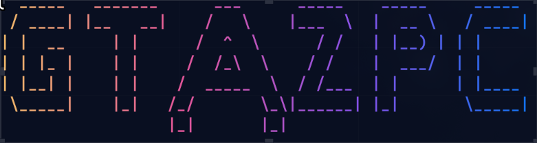

<p align="center">
  <a href="https://github.com/BasGame1/gta2pc">
    
  </a>
</p>

**Native Windows & Linux compatibility runtime and asset toolchain for *Grand Theft Auto VI* (Xbox Series).**


[Translations](docs/i18n/README.md) • [Installation](#installation) • [Architecture & Benchmarks](docs/architecture.md) • [Status Logs](docs/status.md) • [Roadmap](docs/objectives.md) • [Discord](https://discord.gg/ETf4qj5acN) • [Telegram](https://t.me/PixelifyNext)

> **Legal & Local-Only Notice:** This repository contains source code and build scripts only—no game binaries, keys, or copyrighted assets are included. You must supply an unpacked Xbox Series retail copy (`v1.0.2.1`) locally on disk.

---

### How It Works

Instead of emulating the entire Xbox Series console, `gta2pc` translates the game's layers directly to native PC APIs:

- **CPU & OS (`gta6rt`):** Runs the x86-64 game executable natively in user-space while shimming Xbox GDK and kernel calls to Windows or Wine/Proton.
- **Shaders (RDNA2 → SPIR-V):** Extracts and recompiles all **26,503** console GPU shaders into validated Vulkan SPIR-V modules.
- **Graphics & Ray Tracing:** Translates Xbox Direct3D 12 command lists, `PresentX` queues, and BVH4 acceleration structures onto desktop Vulkan.
- **Asset Pipeline:** Unpacks RPF9 archives, BCPack textures (DDS), and AWC audio streams locally during build time.

---

### Current Progress

**Playability:** Boots through intro cinematics, initial setup menus, and story loading screen on Windows and Linux/Proton; stops before 3D world rendering.

- ✅ **Boot & Menu Flow:** Intro videos and story-mode loading screen verified ([Linux/Proton report](docs/linux_proton.md))
- ✅ **Shader Compilation:** **26,503 / 26,503** RDNA2 shaders converted to SPIR-V (`spirv-val` clean)
- ✅ **Asset Extraction:** **382,781** OBJ meshes, BC1–BC7 DDS textures, and **1,589** radio/AWC entries unpacked
- ⚠️ **Graphics & World Frame:** Core D3D12→Vulkan proxy and GPU BVH4 builder working; 3D world rendering in progress

*(See [docs/architecture.md](docs/architecture.md) for full subsystem breakdowns and GPU compatibility tables.)*

---

### Installation

**Requirements:** Windows 10/11 (x64) or 64-bit Linux (Wine/Proton) • Vulkan 1.3 GPU • ~400 GB free disk space • Unpacked Xbox Series `1.0.2.1` directory (`MicrosoftGame.Config` + `.rpf` files).

```bash
git clone --recursive https://github.com/BasGame1/gta6pc.git
cd gta2pc
```

- **Windows:** Run `Build.bat`
- **Linux / macOS:** Run `./Build.sh` (see [docs/linux.md](docs/linux.md) for required packages)

<details>
<summary><b>Build & Fork Notes</b></summary>
<br>

- **Submodules:** Always clone with `--recursive` so `third_party/rpf9-explorer` is fetched; GitHub's "Download ZIP" omits submodules.
- **Output Path:** The builder auto-detects your local game folder across standard user directories/drive roots and outputs the compiled runtime to `Documents\Leonida`.
- **Upstream Lineage:** `gta2pc` builds upon [NotRexed's Leonida](https://github.com/ItsNotRexed/Leonida) and [ubiquitarianism's Leonida Continued](https://github.com/ubiquitarianism/leonida), focusing on Linux/Proton execution and build reliability.

</details>

---

### Mirrors & Community

- **GitHub:** https://github.com/BasGame1/gta6pc
- **GitLab:** https://gitlab.com/BasGame1/gta2pc
- **Telegram:** https://t.me/PixelifyNext

> [!NOTE]
> The prs/ folder was used as a way to record the prs related to the project, does not have any practical use now. Ignore it 
